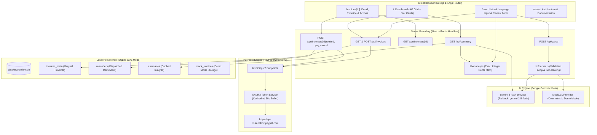

# InvoiceFlow AI

> **Natural Language Invoicing & Intelligent Receivables for Freelancers**  
> *Built for the PayPal AI Hackathon: "Build What's Next with PayPal and AI"*

[](LICENSE)
[](https://nextjs.org/)
[](https://developer.paypal.com/docs/api/invoicing/v2/)
[](https://ai.google.dev/)
[](https://www.typescriptlang.org/)

---

## Pitch

**InvoiceFlow AI** turns natural language descriptions into professional, payable PayPal invoices in seconds. Instead of navigating tedious billing forms, freelancers and agencies simply describe their work in plain English (e.g. *"Invoice Rahul Mehta (rahul@example.com) $450 for logo design and $120 for two revisions, due in 15 days"*). Google Gemini extracts structured line items, quantities, rates, and relative dates into strict Zod schemas; our server calculates totals using integer-cents arithmetic with zero rounding errors; and the app seamlessly dispatches official invoices, tracks statuses in real-time, drafts tone-tailored payment reminders, and computes executive business health insights through PayPal's Invoicing v2 API.

---

## Key Features

- 💬 **Natural Language to PayPal Invoice**: Transform unstructured descriptions, hourly rates, and relative dates (*"net 30"*, *"in two weeks"*) into structured billing records.
- 🛡️ **Zero Floating-Point Financial Math**: All currency additions, multipliers, and summaries are computed in server code via integer cents (`lib/money.ts`). The LLM is strictly prohibited from calculating money totals, eliminating hallucinations.
- 💳 **Complete PayPal Invoicing v2 Lifecycle**: Generates official invoice numbers, creates drafts, sends invoices with hosted payer links, dispatches reminders, cancels invoices, and records payments.
- 📊 **Real-Time Financial Dashboard**: Four live stat cards (*Total Invoiced*, *Paid*, *Outstanding*, *Overdue*) computed directly from PayPal data, accompanied by a high-performance, sortable, and filterable AG Grid Community table.
- 🤖 **Contextual AI Payment Reminders**: Gemini drafts customized reminder emails matching the invoice age and selected tone (*Friendly*, *Neutral*, *Firm*). Invoices are only sent via PayPal upon explicit merchant approval.
- 📈 **AI Executive Business Health Summary**: Precomputes financial totals and sends only verified metrics to Gemini for an executive plain-English narrative and actionable growth suggestion, cached in SQLite via SHA-256 hash.
- 🚀 **Full Offline Demo Mode**: Zero-configuration sandbox demo mode that runs out of the box with SQLite-persisted mock PayPal operations and a deterministic mock LLM—no API keys required.
- 🌓 **Fintech UI & Accessibility**: Accessible labels, keyboard focus rings, light/dark mode support, responsive mobile navigation, and celebratory send animations.

---

## Architecture Diagram



---

## Prerequisites

- **Node.js**: v18.17.0+ (Tested through v24.x)
- **npm**: v9.0.0+
- **PayPal Developer Account**: [developer.paypal.com](https://developer.paypal.com) (for Real Mode)
- **Google Gemini API Key**: [aistudio.google.com/apikey](https://aistudio.google.com/apikey) (for Real Mode)

---

## Step-by-Step Setup

### Option A: Run in Demo Mode (Zero Setup)

If you don't have PayPal sandbox credentials or a Gemini API key handy, InvoiceFlow AI runs instantly in **Demo Mode**:

```bash
git clone https://github.com/your-username/invoiceflow-ai.git
cd invoiceflow-ai
npm install
npm run dev
```

Visit **[http://localhost:3000](http://localhost:3000)**. The app automatically enters Demo Mode, displaying pre-seeded demo invoices, simulated PayPal Invoicing v2 operations in SQLite, and deterministic AI parsing for the example prompt chips.

---

### Option B: Real Mode with PayPal Sandbox & Google Gemini

#### 1. Create a PayPal Sandbox App
1. Log in to the [PayPal Developer Dashboard](https://developer.paypal.com/dashboard/).
2. Navigate to **Apps & Credentials** and ensure you are in the **Sandbox** tab.
3. Click **Create App**, name it (e.g. `InvoiceFlow AI`), and select your sandbox business account.
4. Under **App Settings > Features**, **ensure the "Invoicing" checkbox is checked**.
5. Copy your **Client ID** and **Client Secret**.

#### 2. Get a Google Gemini API Key
1. Go to [Google AI Studio](https://aistudio.google.com/apikey).
2. Click **Create API Key** and copy your generated key.

#### 3. Configure Environment Variables
Create a `.env` file in the project root:

```bash
cp .env.example .env
```

Edit `.env` with your real credentials:

```env
# PayPal Invoicing API (Sandbox)
PAYPAL_CLIENT_ID=your_sandbox_client_id_here
PAYPAL_CLIENT_SECRET=your_sandbox_client_secret_here
PAYPAL_BASE_URL=https://api-m.sandbox.paypal.com

# Google Gemini API
GEMINI_API_KEY=your_gemini_api_key_here
LLM_MODEL=gemini-3-flash-preview

# Invoicer Business Profile
BUSINESS_NAME=Your Business Name
BUSINESS_EMAIL=your_sandbox_business_email@example.com

# App Configuration
DEFAULT_CURRENCY=USD
DEMO_MODE=false
```

#### 4. Install Dependencies & Verify
```bash
npm install

# Verify your PayPal Sandbox connection
npm run test:paypal

# Verify your Gemini AI connection
npm run test:gemini
```

#### 5. Launch the Application
```bash
npm run dev
```
Open **[http://localhost:3000](http://localhost:3000)** in your browser.

---

## AI Tools Used & How

| AI Capability | Model & Library | How It Is Implemented | Guardrails & Validation |
| :--- | :--- | :--- | :--- |
| **Natural Language Invoice Parser** | `gemini-3-flash-preview` via `@google/genai` (v1beta API) | Analyzes unstructured prompts; extracts client name, client email, line items (rate, quantity, description), currency, and relative due dates. | • Native `responseMimeType: "application/json"` with JSON schema.<br>• Strict Zod validation (`lib/schemas.ts`).<br>• Automated 1-turn retry with validation feedback on error.<br>• Prompt injection isolation via `<user_invoice_description>` data boundaries.<br>• Zero money calculations (the LLM never computes totals). |
| **Contextual Reminder Drafter** | `gemini-3-flash-preview` via `@google/genai` | Generates personalized email subject and message lines based on invoice status, recipient name, amount, and selected tone (*Friendly*, *Neutral*, *Firm*). | • Merchant review gate: reminders are NEVER sent automatically.<br>• Output constrained to `{ subject, message }`.<br>• Rate-limited to comply with PayPal's 2-reminder-per-day restriction. |
| **Executive Business Health Summary** | `gemini-3-flash-preview` via `@google/genai` | Produces an executive 2-sentence financial health narrative and 1 concrete cash-flow suggestion for the merchant dashboard. | • Grounded strictly on precomputed financial totals generated in code.<br>• Cached in SQLite keyed by SHA-256 hash of stats, eliminating redundant API calls. |
| **Resilience & Rate-Limit Handling** | Exponential Backoff Layer | Intercepts HTTP 429 (`RESOURCE_EXHAUSTED`), HTTP 503 (`UNAVAILABLE`), and high demand spikes with a 3-retry exponential backoff (1s, 2s, 4s). | • Transparently falls back to `gemini-2.5-flash` if the primary model is unavailable.<br>• Friendly error messaging if quotas are exhausted. |

---

## PayPal APIs Used

InvoiceFlow AI integrates directly with **PayPal Invoicing API v2**:

| Endpoint | Method | Purpose in InvoiceFlow AI |
| :--- | :--- | :--- |
| `/v1/oauth2/token` | `POST` | Exchanges client credentials for an OAuth2 bearer token; cached in-memory with a 60-second safety buffer. |
| `/v2/invoicing/generate-next-invoice-number` | `POST` | Retrieves the next sequential merchant invoice number (e.g. `INV2-0004`). |
| `/v2/invoicing/invoices` | `POST` | Creates a new draft invoice containing line items, recipient details, and payment terms. |
| `/v2/invoicing/invoices/{invoice_id}/send` | `POST` | Publishes the draft invoice, dispatches an email notification to the customer, and activates the PayPal-hosted payment link. |
| `/v2/invoicing/invoices` | `GET` | Fetches paginated lists of merchant invoices for the dashboard AG Grid table. |
| `/v2/invoicing/invoices/{invoice_id}` | `GET` | Retrieves full invoice details, item breakdowns, status histories, and buyer view links. |
| `/v2/invoicing/invoices/{invoice_id}/remind` | `POST` | Sends formal payment reminder notifications to recipients through PayPal's email infrastructure. |
| `/v2/invoicing/invoices/{invoice_id}/cancel` | `POST` | Cancels an active or unpaid invoice with an optional internal or client-facing note. |
| `/v2/invoicing/invoices/{invoice_id}/payments` | `POST` | Records an external or sandbox payment against an invoice (transitions status to `PAID` / `MARKED_AS_PAID`). |

---

## Demo Mode

When `DEMO_MODE=true` or when credentials are not configured, InvoiceFlow AI operates in **Full Demo Mode**:

1. **Mock PayPal Client (`lib/paypal.ts`)**:
   - Generates sequential `INV2-DEMO-XXXX` invoice numbers.
   - Saves drafts and updates statuses (`DRAFT` → `SENT` → `PAID` / `CANCELLED`) in SQLite (`data/invoiceflow.db`).
   - Seeds 3 realistic invoices on first launch:
     - `INV2-DEMO-0001`: **Overdue** sent invoice ($570.00).
     - `INV2-DEMO-0002`: **Paid** fullstack consulting invoice ($3,400.00).
     - `INV2-DEMO-0003`: **Draft** international design invoice (€1,000.00).
   - Real-time updates persist across page reloads.
2. **Deterministic Mock LLM (`lib/llm.ts`)**:
   - Accurately parses the 3 clickable example prompt chips on `/new`.
   - Generates realistic tone-tailored reminders and executive financial summaries without needing a Gemini API key.
3. **Demo Banner**:
   - A clear banner is displayed across the top of the app indicating that Demo Mode is active, with a direct link to the setup instructions.

---

## Testing & Quality Assurance

InvoiceFlow AI includes comprehensive test suites across financial arithmetic, SQLite persistence, AI parsing, and API route handlers:

```bash
# Run all Vitest unit & integration tests
npm test

# Run tests in watch mode
npx vitest

# Run standalone end-to-end sandbox verification scripts
npm run test:paypal      # Phase 1: PayPal credentials & draft/send
npm run test:gemini      # Phase 2: Live Gemini structured output
npm run test:phase3      # Phase 3: Create & send full flow
npm run test:phase4      # Phase 4: Dashboard stats calculation
npm run test:phase5      # Phase 5: Reminders, payments, & summaries
```

### Build & Type Verification
```bash
# Run full Next.js production build with strict type checking
npm run build
```

---

## Security & Reliability Principles

- **Zero Secrets in Source Control**: `.env` and `data/` are strictly ignored in `.gitignore`. No API keys or secrets are ever exposed to client bundles.
- **Server-Side API Gateway**: All interactions with PayPal Invoicing v2 and Google Gemini occur exclusively within server-side Next.js route handlers.
- **Fail-Safe Network Layer**: Centralized `fetchWithRetry` utility featuring a 15-second timeout and automatic retry on 5xx errors.
- **Structured Error Tracing**: Full error diagnostics capturing PayPal's `paypal-debug-id` for rapid debugging.
- **Strict Financial Typing**: Money values are represented as integer cents internally and formatted to fixed 2-decimal-place strings for API compatibility.

---

## Known Limitations & Future Work

- **PayPal Webhooks Integration**: Currently, status updates (such as external customer payments on PayPal.com) are reflected when viewing the invoice or refreshing the dashboard. Implementing PayPal Webhook listeners (`INVOICING.INVOICE.PAID`) will allow instant push-based status updates.
- **Multi-Currency Real-Time Conversion**: Invoices can be created in any ISO currency (USD, EUR, GBP, CAD, AUD, INR). In a future release, real-time FX rates could convert multi-currency receivables into a consolidated single-currency dashboard view.
- **Recurring & Scheduled Invoices**: Adding support for PayPal's recurring invoice schedules for subscription and retainer-based freelance contracts.
- **Multi-Merchant Organization Profiles**: Allowing agencies to switch between multiple PayPal business profiles within a single dashboard.

---

## License

This project is licensed under the [MIT License](LICENSE).
