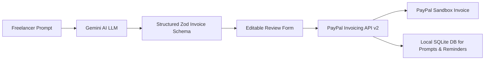

# InvoiceFlow AI Architecture

## Overview
InvoiceFlow AI streamlines freelance invoicing by converting conversational text into structured PayPal invoices via Google Gemini AI and PayPal's Invoicing v2 API (Sandbox only).

## Security & Reliability
- **Strict Server-Side Boundary**: All PayPal credentials and Gemini API keys run only in server-side routes and scripts.
- **Exact Money Math**: All financial additions and calculations avoid floating point arithmetic.
- **Resilience**: Centralized fetch wrapper with 15s timeout and automatic 5xx retry with backoff.
- **Local Persistence**: SQLite database storing original prompts, AI reminders, and cached business summaries.
