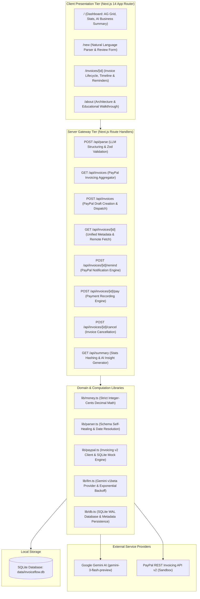
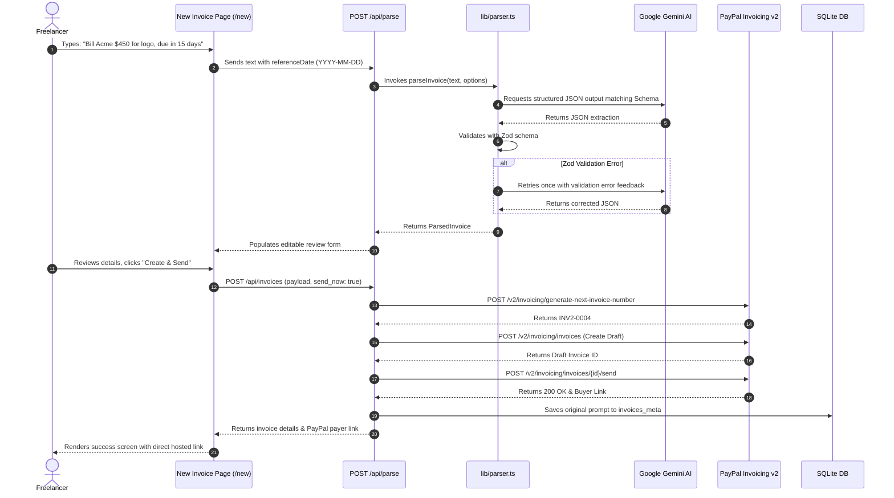
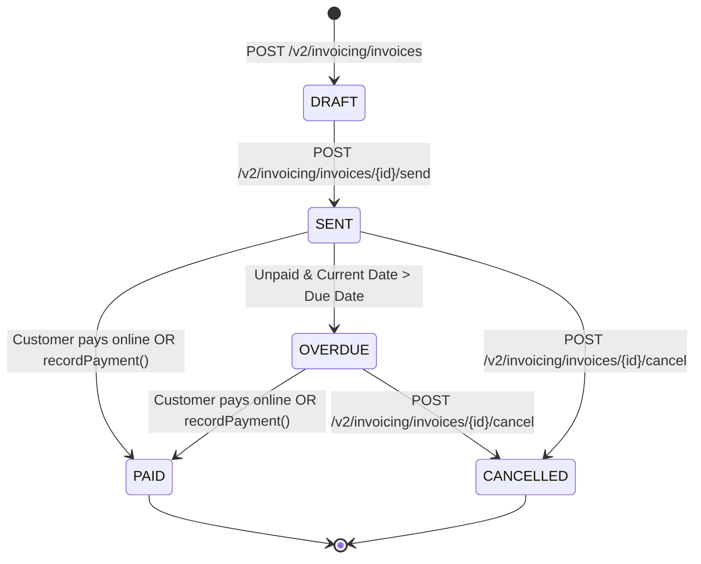

# InvoiceFlow AI — Technical Architecture

This document details the architectural design, security boundaries, payment flows, and AI integration mechanisms of **InvoiceFlow AI**, submitted for the PayPal AI Hackathon (*"Build What's Next with PayPal and AI"*).

---

## 1. System Overview

InvoiceFlow AI simplifies freelance payment collection by decoupling conversational invoice inception from the structured, rigorous constraints of the **PayPal Invoicing v2 API**.

---

## 2. Core Architectural Pillars

### 2.1. Strict Server-Side Security Boundary
- **Secret Isolation**: Neither `PAYPAL_CLIENT_SECRET` nor `GEMINI_API_KEY` are ever bundled or exposed to the browser client. All external provider communications occur strictly inside server-side Route Handlers.
- **Data Boundary Protection**: User-submitted invoice prompts are wrapped in strict XML data boundary markers (`<user_invoice_description>`) to prevent prompt-injection attacks. Instructions explicitly command the model to treat the content solely as data and never as execution directives.

### 2.2. Zero Floating-Point Financial Safety
Financial calculations involving floating-point numbers in JavaScript (`0.1 + 0.2 === 0.30000000000000004`) lead to critical rounding discrepancies and API rejections.
- **Integer Cents Representation**: In `lib/money.ts`, all monetary amounts are converted to integer cents (`100 cents = $1.00`) before mathematical operations:
  $$\text{totalCents} = \sum_{i=1}^{n} (\text{quantity}_i \times \text{unitPriceCents}_i)$$
- **LLM Arithmetic Prohibition**: The LLM is explicitly forbidden from computing totals. It extracts only quantities and unit prices. The server computes invoice sums, line totals, and dashboard statistics deterministically.

---

## 3. Data Flow & Lifecycles

### 3.1. Natural Language Invoicing Pipeline

---

## 4. PayPal Invoicing v2 State Machine

PayPal invoices traverse a well-defined lifecycle managed through the application:

### Supported PayPal Actions:
1. **Create Draft**: Stores full draft invoice in PayPal with itemized pricing and payment terms.
2. **Send Invoice**: Publishes the invoice and issues a secure buyer-hosted URL (`payer-view`).
3. **Send Reminder**: Dispatches formal payment reminders via PayPal's notification engine (subject to PayPal's 2-reminder-per-day rate limit).
4. **Record Payment**: Marks an invoice as `PAID` / `MARKED_AS_PAID` for sandbox testing or offline bank transfers.
5. **Cancel Invoice**: Cancels outstanding invoices with an optional memo to the client.

---

## 5. Persistence & Caching Strategy

InvoiceFlow AI employs a hybrid persistence model:

1. **PayPal Invoicing Cloud**: Acts as the single source of truth for all live invoice records, recipient billing information, line items, and payment transactions.
2. **SQLite (`data/invoiceflow.db` in WAL mode)**:
   - `invoices_meta`: Links PayPal invoice IDs to their original natural language prompts and creation timestamps.
   - `reminders`: Stores audit logs of all AI-drafted payment reminders sent through the system.
   - `summaries`: Caches AI business insights keyed by an exact SHA-256 hash of the precomputed financial stats (`stats_hash`).
   - `mock_invoices`: Stores simulated PayPal invoices and lifecycle transitions when running in **Demo Mode**.

---

## 6. Demo Mode vs. Real Mode

To ensure smooth evaluation by hackathon judges regardless of sandbox account availability, InvoiceFlow AI features an integrated dual-engine architecture:

| Component | Real Mode (`DEMO_MODE=false`) | Demo Mode (`DEMO_MODE=true` or missing keys) |
| :--- | :--- | :--- |
| **Payment Backend** | Live PayPal Invoicing v2 Sandbox | SQLite-persisted mock client with realistic responses |
| **Invoice Numbers** | Generated by PayPal sequence engine | Sequenced `INV2-DEMO-XXXX` format |
| **AI LLM** | Google Gemini (`gemini-3-flash-preview`) | Deterministic Mock LLM parsing example prompts & reminders |
| **Initial Data** | Live invoices fetched from PayPal Sandbox | Pre-seeded with 3 realistic invoices (Overdue, Paid, Draft) |
| **UI Indication** | PayPal Sandbox badge | Prominent top banner with setup link |

---

## 7. Reliability & Fault Tolerance

- **OAuth2 Token Caching**: PayPal access tokens are cached in-memory with a 60-second safety buffer to eliminate unnecessary authentication overhead.
- **5xx Automatic Retry**: Server requests retry transient gateway failures (`500`, `502`, `503`, `504`) with a 1000ms delay.
- **Gemini Exponential Backoff**: Gemini API calls handle HTTP 429 (`RESOURCE_EXHAUSTED`) and HTTP 503 (`UNAVAILABLE`) with 3 retry attempts using exponential backoff (1s, 2s, 4s).
- **Graceful Error Surfacing**: PayPal error responses are parsed for both human-readable messages and PayPal `debug_id` values for immediate diagnostics.
